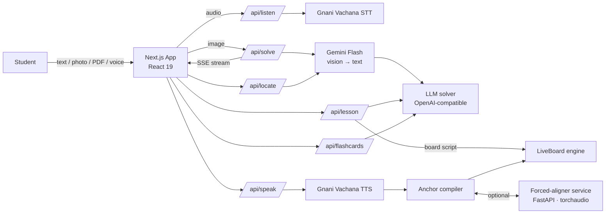

<div align="center">

# StepWise

**An AI tutor that doesn't just give answers. It teaches them, step by step, on a live whiteboard, in your language.**


</div>

---

## The problem

Students who are stuck on homework usually find one of two things online: a bare final answer, which teaches nothing, or a long video that isn't about their question. Most tools also assume the student reads English, so millions of learners who think in Hindi, Tamil, Kannada, Bengali or Urdu are left out.

## The solution

StepWise lets a student **snap a photo, paste text, upload a PDF or just speak** the question. It then:

1. **Reads** the problem, including handwriting, printed math and diagrams.
2. **Solves** it as a clear, streamed, step-by-step explanation with properly typeset math.
3. **Teaches** it as an animated whiteboard lesson. A virtual stylus writes each step while a narrator explains it aloud, with the voice and the board kept in sync word by word.
4. **Reinforces** it with auto-generated flashcards, quizzes and study guides.

All of this works in **11 languages**, including 9 Indian languages and right-to-left Urdu and Arabic.

---

## Key features

| | Feature | What it does |
|---|---|---|
| 📷 | **Multimodal input** | Text, photos (camera or paste), PDF pages and voice. Photos are converted to text by a vision model before solving. |
| ⚡ | **Streamed solutions** | Answers stream token-by-token over Server-Sent Events, with Markdown and KaTeX math rendering. |
| 🧑‍🏫 | **LiveBoard whiteboard tutor** | A 60 fps canvas that writes each step with a virtual stylus, moves its camera to follow the work, draws sanitized SVG diagrams and highlights key ideas. |
| 🔊 | **Synced narration** | Text-to-speech narration is aligned with what's on the board. It uses native speech marks when available, falls back to forced alignment, and finally falls back to a syllable-based estimate. |
| 🃏 | **Study modes** | Solver, Whiteboard Tutor, Flashcards, Quiz and Study Guide, all from the same question. |
| 🌏 | **11 languages** | English, Hindi, Kannada, Tamil, Telugu, Malayalam, Marathi, Bengali, Gujarati, Urdu and Arabic, with full RTL layout. |
| 🎙️ | **Voice in, voice out** | Ask by speaking and listen to the explanation, powered by Gnani Vachana speech-to-text and text-to-speech. |
| 📄 | **PDF locate** | Upload a worksheet and StepWise finds and crops the question you mean. |
| 🕘 | **History & playback control** | Past sessions are saved locally. Lessons can be paused, replayed and sped up or slowed down. |

---

## Architecture



### How a whiteboard lesson is produced

1. **Script generation.** The LLM writes a lesson script: narration text interleaved with board instructions such as text, math, shapes, diagrams, highlights and camera moves.
2. **Parsing & validation.** The script is checked against a typed schema (zod). Tags are stripped from the spoken text and kept as timing anchors.
3. **Layout.** A continuous layout solver places each block on the board, avoids overlaps and routes connectors.
4. **Speech & timing.** The narration is synthesized. The anchor compiler then maps each board action to a moment in the audio, choosing the best timing source available:
   - `native_marks`: word timestamps returned by the TTS provider
   - `forced_alignment`: the local aligner service (MMS forced alignment)
   - `syllable_estimate`: a language-aware pacing model, used when neither of the above is available
5. **Playback.** A global playback engine drives the stylus, text reveal, math clipping, stroke drawing and camera on `requestAnimationFrame`, all locked to the audio clock.

A deeper write-up is in [`docs/animation_engine_architecture.md`](docs/animation_engine_architecture.md).

---

## Tech stack

| Layer | Technology |
|---|---|
| Framework | Next.js 16 (App Router), React 19, TypeScript |
| Animation | framer-motion, GSAP, custom rAF playback engine |
| Math & docs | KaTeX, pdf.js |
| Validation | zod |
| Vision / OCR | Google Gemini Flash |
| Reasoning | `openai/gpt-oss-120b` on Groq (works with any OpenAI-compatible endpoint) |
| Speech | Gnani Vachana (STT + TTS) |
| Alignment service | Python, FastAPI, PyTorch / torchaudio (MMS forced alignment), uroman |
| Typography | Inter (UI), Kalam (handwritten board) |

---

## Project structure

```
.
├── app/
│   ├── api/                 # Server routes: solve, lesson, flashcards, listen, speak, locate
│   ├── chat/                # Streamed solver chat + flashcards UI
│   ├── home/                # Input card and whiteboard tutor (LiveBoard, stylus, controls)
│   └── shell/               # App shell: sidebar, top bar
├── lib/
│   ├── liveboard/           # Camera, text pacing, reveal math, SVG sanitizing
│   ├── continuous/          # Layout solver, tag parser, board surface, validation
│   ├── engine/              # Global playback engine
│   ├── compiler/            # Narration → board anchor compiler
│   ├── aligner/             # Hybrid aligner client
│   ├── tts/                 # TTS provider abstraction (Gnani + mock)
│   ├── languages.ts         # Language registry (direction, voice, script)
│   └── modes.ts             # Solver / Tutor / Flashcards / Quiz / Study Guide
├── services/aligner/        # Optional FastAPI forced-alignment microservice
├── eval/                    # Narration-sync evaluation harness + audio fixtures
└── docs/                    # Architecture notes
```

---

## Getting started

### Prerequisites

- **Node.js 20+** and npm
- API keys for **Google Gemini**, **Groq** and **Gnani**
- *(Optional)* **Python 3.10+** for the forced-alignment service

### 1. Install

```bash
npm install
```

### 2. Configure

```bash
cp .env.example .env.local
```

| Variable | Required | Description |
|---|---|---|
| `GEMINI_API_KEY` | ✅ | Reads photos and PDF pages into text |
| `GEMINI_MODEL` | | Primary vision model (default `gemini-3.8-flash`) |
| `GEMINI_FALLBACK_MODEL` | | Used if the primary model is unavailable (default `gemini-3.6-flash`) |
| `GROQ_API_KEY` | ✅ | Solver and lesson-script model |
| `GROQ_MODEL` | | Defaults to `openai/gpt-oss-120b` |
| `GNANI_API_KEY` | ✅ | Speech-to-text and text-to-speech |
| `ALIGNER_SERVICE_URL` | | Forced-aligner address (default `http://127.0.0.1:8010`) |

> StepWise talks to any OpenAI-compatible chat endpoint. To use a different provider or a self-hosted model, set `LLM_BASE_URL`, `LLM_MODEL` and `LLM_API_KEY`.

### 3. Run

```bash
npm run dev
```

Open **http://localhost:3000**.

### 4. *(Optional)* Start the forced-aligner

This makes narration sync more precise for languages whose TTS voice doesn't return word timestamps. StepWise still works without it, using the syllable-based estimate.

```bash
pip install -r services/aligner/requirements.txt
```

```bash
cd services/aligner && python align_server.py
```

The service listens on `http://127.0.0.1:8010` and exposes `GET /health` and `POST /align`.

---

## API reference

| Route | Method | Purpose |
|---|---|---|
| `/api/solve` | POST | Solves a text or image problem and streams the answer over SSE |
| `/api/lesson` | POST | Generates a timed whiteboard lesson script |
| `/api/flashcards` | POST | Generates flashcards / quiz items from a problem |
| `/api/listen` | POST | Speech-to-text for voice questions |
| `/api/speak` | POST | Text-to-speech narration with timing marks |
| `/api/locate` | POST | Finds and crops a question inside an uploaded PDF page |

All request bodies are validated with zod at the route boundary.

---

## Testing & evaluation

```bash
npm test
```

This runs the unit suite with Node's built-in test runner. It covers request validation, SSE stream parsing, layout solving, tag parsing, text pacing, anchor compilation, SVG sanitizing, history and more.

```bash
npm run eval
```

This runs the **narration-sync evaluation**, which measures how closely board actions line up with the spoken audio on the English and Hindi fixtures in `eval/`.

---

## Roadmap

- [ ] Rate limiting and abuse protection on the API routes before a public deployment
- [ ] User accounts with cloud-synced history
- [ ] Teacher mode: share a lesson link with a whole class
- [ ] Offline / on-device models for low-connectivity regions
- [ ] More languages through the language registry (adding one is a single entry)

---

## Team

| Name | Role |
|---|---|
| **Prathviraj Singh** | Team Lead & System Architect |
| **Navya Awasthi** | Social Media |

## Acknowledgements

- [Google Gemini](https://ai.google.dev/) for vision understanding
- [Groq](https://groq.com/) for fast LLM inference
- [Gnani.ai](https://gnani.ai/) for Indic speech recognition and synthesis
- [Meta MMS](https://github.com/facebookresearch/fairseq/tree/main/examples/mms) and torchaudio for multilingual forced alignment
- [KaTeX](https://katex.org/) for math rendering

## License

Released under the MIT License. *(Add a `LICENSE` file before submission.)*
