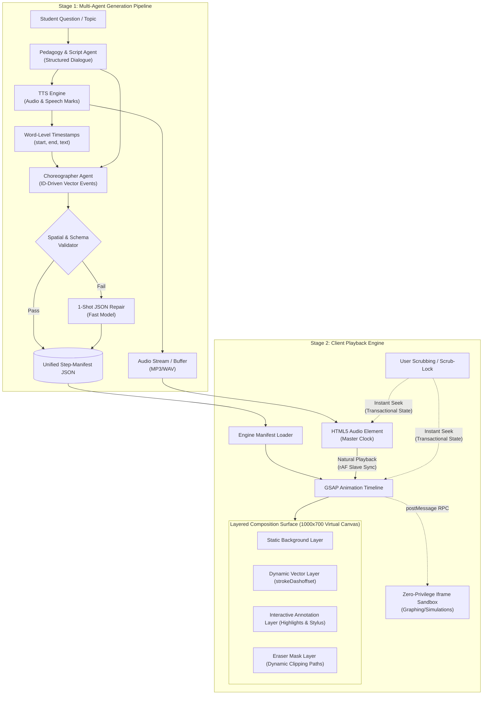

# StepWise Manifest-Driven Whiteboard Animation Engine: Architectural Specification & Implementation RFC

## 1. Executive Summary & Problem Context

In StepWise (an agentic whiteboard study tutor), whiteboard animations were previously generated through a single-stage LLM completion that coupled narration sentences (`say`) with loose visual shapes (`draw`), utilizing naive character-ratio delay heuristics (`(pos / say.length) * clipSeconds`) and static CSS keyframe stroke transitions (`stroke-dashoffset`). 

This caused three critical degradation patterns:
1. **Temporal Desynchronization:** Spoken explanations drifted significantly from the on-board stroke drawing reveals due to lack of phonetic/word-boundary timing data.
2. **Semantic Mismatches:** Hallucinated geometric coordinates and shapes failed to convey the underlying educational concepts explained by the voice narration.
3. **Absence of Dynamic Whiteboard Motion:** Lack of stateful whiteboard interactions (e.g., progressive erasing, dynamic highlighting, camera zooms, virtual stylus motion, and interactive math/geometry simulations).

To solve these deficiencies, this RFC defines a **Manifest-Driven Multi-Agent Animation Engine** that decouples pedagogical narrative generation from client-side visual execution.

---

## 2. System Architecture & End-to-End Pipeline



---

## 3. Data Specification: The Step-Manifest Schema

The Manifest acts as the immutable contract between the backend generation pipeline and the client-side playback runtime.

```typescript
export type ManifestCommandType = "DRAW" | "HIGHLIGHT" | "ERASE" | "CAMERA_ZOOM" | "EXECUTE_SANDBOX";

export interface SpeechMark {
  timeMs: number;     // Absolute timestamp within audio clip (ms)
  type: "word";
  value: string;      // Spoken word
  startChar: number;
  endChar: number;
}

export interface BaseVectorCommand {
  id: string;                      // Unique deterministic element ID
  action: ManifestCommandType;
  startMs: number;                 // Scheduled start relative to step audio (ms)
  durationMs: number;              // Animation duration (ms)
  easing?: string;                 // GSAP easing string (e.g., "power2.out")
}

export interface DrawCommand extends BaseVectorCommand {
  action: "DRAW";
  targetLayer: "dynamicVector";
  shape: 
    | { type: "line" | "arrow"; from: [number, number]; to: [number, number]; strokeWidth?: number }
    | { type: "circle"; x: number; y: number; r: number }
    | { type: "ellipse"; x: number; y: number; rx: number; ry: number }
    | { type: "rect"; x: number; y: number; w: number; h: number; rx?: number }
    | { type: "path"; d: string }
    | { type: "latex"; x: number; y: number; tex: string; fontSize: number }
    | { type: "label"; x: number; y: number; text: string; note?: string };
  style: {
    color: "ink" | "purple" | "orange" | "green" | "red" | "blue";
    dashArray?: number;
    showStylus?: boolean;
  };
}

export interface HighlightCommand extends BaseVectorCommand {
  action: "HIGHLIGHT";
  targetElementId: string;         // References previously drawn element ID
  style: "pulse" | "halo" | "marker_stroke";
  color?: string;
  intensity?: number;
}

export interface EraseCommand extends BaseVectorCommand {
  action: "ERASE";
  targetElementIds: string[];      // Element IDs to remove or mask
  technique: "mask_wipe" | "reverse_stroke" | "scribble_mask";
}

export interface CameraZoomCommand extends BaseVectorCommand {
  action: "CAMERA_ZOOM";
  targetViewport: { x: number; y: number; width: number; height: number };
}

export interface SandboxCommand extends BaseVectorCommand {
  action: "EXECUTE_SANDBOX";
  sandboxId: string;
  widgetType?: "function_plotter" | "coordinate_grid" | "geometry_matrix";
  params?: Record<string, unknown>;
  customScriptPayload?: string;    // Executed in zero-privilege iframe if present
}

export type VectorCommand = 
  | DrawCommand 
  | HighlightCommand 
  | EraseCommand 
  | CameraZoomCommand 
  | SandboxCommand;

export interface StepManifest {
  stepIndex: number;
  speech: {
    audioUrl: string;
    durationMs: number;
    transcript: string;
    speechMarks: SpeechMark[];
  };
  commands: VectorCommand[];
}

export interface LessonManifest {
  lessonId: string;
  title: string;
  subtitle?: string;
  steps: StepManifest[];
  metadata: {
    generatedAt: string;
    virtualCanvas: { width: 1000; height: 700 };
  };
}
```

---

## 4. Multi-Agent Backend Pipeline Architecture

### Stage 1: Pedagogy & Script Generation
- **Input:** Student query, topic, persona, and learning level.
- **Role:** Generates progressive, pedagogical prose structured into 4–8 discrete learning milestones.
- **Output:** Clean spoken scripts per step (`say`) optimized for conversational cadence.

### Stage 2: TTS & Speech-Marks Extraction
- **Role:** Transmits script to backend TTS service with Speech Marks extraction enabled.
- **Output:**
  1. Audio buffer / persistent storage URL.
  2. Array of word-level timestamp offsets (`SpeechMark[]`).

### Stage 3: Choreographer Agent
- **Input:** Spoken script, duration metrics, and exact word boundary markers.
- **Role:** Maps pedagogical milestones into visual geometry, assigning microsecond triggers for `DRAW`, `HIGHLIGHT`, `ERASE`, and `CAMERA_ZOOM` to coincide with relevant words.
- **Output:** Fully compiled `VectorCommand[]` referencing persistent IDs.

### Stage 4: Spatial & Schema Validator
- **Role:** 
  1. Clamps coordinates within the 1000×700 virtual canvas.
  2. Runs AABB (Axis-Aligned Bounding Box) collision detection between labels, shapes, and margins.
  3. Validates SVG path grammar.
  4. If validation fails, triggers a high-speed 1-shot repair loop; otherwise emits final `LessonManifest`.

---

## 5. Client Playback Engine & Synchronization Protocol

### Audio-GSAP Master-Slave Clock Binding
```typescript
class StepWisePlaybackEngine {
  private audio: HTMLAudioElement;
  private timeline: gsap.core.Timeline;
  private isScrubbing: boolean = false;
  private rafId: number | null = null;

  constructor(audioEl: HTMLAudioElement, commands: VectorCommand[]) {
    this.audio = audioEl;
    this.timeline = this.buildGSAPTimeline(commands);
    this.initMasterClockSync();
  }

  private initMasterClockSync() {
    const syncLoop = () => {
      if (!this.isScrubbing && !this.audio.paused) {
        // Tightly bind timeline playhead to audio.currentTime
        this.timeline.time(this.audio.currentTime);
      }
      this.rafId = requestAnimationFrame(syncLoop);
    };
    this.rafId = requestAnimationFrame(syncLoop);
  }

  // Transactional Scrubbing with Scrub-Lock Flag
  public onScrubStart() {
    this.isScrubbing = true;
    this.audio.pause();
    this.timeline.pause();
  }

  public onScrubSeek(targetTimeSeconds: number) {
    if (!this.isScrubbing) return;
    this.audio.currentTime = targetTimeSeconds;
    this.timeline.time(targetTimeSeconds); // Instant state reconciliation forward & backward
  }

  public onScrubEnd(resumePlayback: boolean) {
    this.isScrubbing = false;
    if (resumePlayback) {
      this.audio.play();
    }
  }

  public setSpeed(multiplier: number) {
    this.audio.playbackRate = multiplier;
    this.timeline.timeScale(multiplier);
  }

  public destroy() {
    if (this.rafId) cancelAnimationFrame(this.rafId);
    this.timeline.kill();
  }
}
```

### Layered Composition Canvas & Virtual Stylus
The client splits the 1000×700 SVG canvas into 4 deterministic layers:
1. **Static Background Layer (`#layer-bg`):** Persistent grid, axes, and watermarks.
2. **Dynamic Vector Layer (`#layer-vectors`):** SVG shapes, strokes, and LaTeX nodes. Strokes animate fluidly using `strokeDashoffset` from `strokeDasharray: length`.
3. **Interactive Annotation Layer (`#layer-annotations`):** Transient highlights, pointer halos, and a decoupled virtual stylus element (`#virtual-stylus`) that tracks the active stroke coordinate `(x, y)` in real-time.
4. **Canvas Eraser Mask Layer (`#layer-eraser-masks`):** SVG `<clipPath>` and `mask` elements that dynamically occlude target element IDs during `ERASE` commands without re-rendering or tearing the DOM tree.

---

## 6. Secure Hybrid Code Execution Sandbox

Interactive simulations (such as function graphing, coordinate proofs, and physics models) follow a two-tier strategy:

1. **Parametric Component Registry (Fast Path):**
   - High-performance, pre-compiled React/SVG widgets:
     - `<FunctionPlotter f="x^2 - 4x + 3" domain={[-5, 5]} />`
     - `<CoordinatePlane points={[[0,0], [3,4]]} vectors={...} />`
     - `<MatrixTransform matrix={[[1,2],[0,1]]} />`
   - Zero security overhead, 60fps rendering, pure state properties.

2. **Zero-Privilege Iframe Sandbox (Custom Script Path):**
   - **Isolation:** `iframe sandbox="allow-scripts"` with a strict Content Security Policy (`default-src 'none'; script-src 'unsafe-eval' 'self'; style-src 'unsafe-inline'`).
   - **Network Restriction:** All network requests (`fetch`, `XMLHttpRequest`, `WebSocket`, `Worker`) blocked by CSP.
   - **Communication Protocol:** Strongly-typed RPC over `window.postMessage`:
     ```typescript
     type ParentToIframeRPC = 
       | { type: "INIT"; canvasWidth: number; canvasHeight: number; script: string }
       | { type: "SEEK"; timestampMs: number }
       | { type: "SET_PLAYING"; playing: boolean };

     type IframeToParentRPC = 
       | { type: "READY" }
       | { type: "ERROR"; message: string }
       | { type: "INTERACTION_EVENT"; payload: Record<string, unknown> };
     ```
   - **Watchdog Boundary:** An 800ms watchdog timer aborts hung iframe scripts and replaces the container with an SVG fallback chart.

---

## 7. Fault Tolerance & Self-Healing Matrix

| Failure Mode | Detection Point | Automated Recovery Strategy |
|---|---|---|
| **Choreographer Schema / JSON Failure** | Server-side validation gate | Immediate 1-shot repair prompt to LLM (`json_object` mode); if secondary fail, inject safe pre-baked structural diagram fixture. |
| **TTS Speech-Marks Drop / Timeout** | TTS response handler | Extract audio duration from valid MP3 header; apply syllable-weighted acoustic timing matrix across script words without crashing. |
| **Iframe Sandbox Crash / Timeout** | Client watchdog (>800ms or unhandled error) | Tear down iframe, trigger error boundary, and render static vector SVG fallback overlay. |
| **Network Audio Load Failure** | Client audio fetch | Seamlessly transition to silent timeline clock driven by `fallbackMs(transcript)` reading cadence. |

---

## 8. Implementation Roadmap & Phases

- **Phase 1: Engine Foundation & Timeline Core**
  - Implement `StepWisePlaybackEngine` with GSAP timeline binding and HTML5 Audio rAF synchronization.
  - Implement the 4-layer composition SVG canvas (`#layer-bg`, `#layer-vectors`, `#layer-annotations`, `#layer-eraser-masks`).
  - Implement virtual stylus path tracking subroutine.
- **Phase 2: Multi-Agent Choreography & Alignment**
  - Upgrade `/api/lesson` into multi-stage pipeline: Pedagogy Agent -> TTS Speech-Marks -> Choreographer Agent -> Schema Validator.
  - Establish `LessonManifest` schema validation with Zod.
- **Phase 3: Sandbox Integration & Parametric Registry**
  - Build parametric core math widgets (`FunctionPlotter`, `CoordinateGrid`).
  - Implement isolated `sandbox="allow-scripts"` iframe runner with postMessage RPC and 800ms watchdog.
- **Phase 4: Resiliency, Self-Healing & Bi-Directional Scrubbing**
  - Implement scrub-lock transactional state reconciliation.
  - Test and verify reverse scrubbing and timeline seek accuracy.
